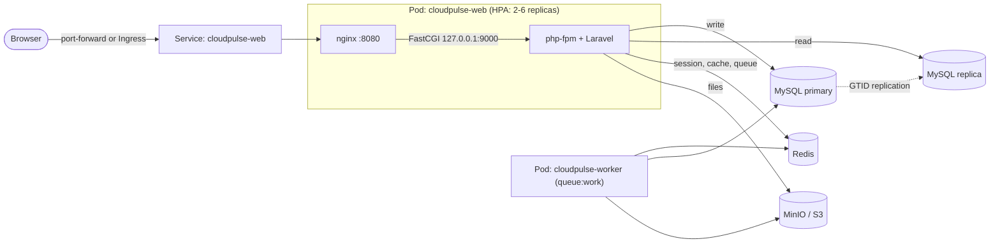

# CloudPulse

From the outside, CloudPulse is a simple **Dashboard + File Upload** application. Its true purpose is to demonstrate enterprise DevOps practices end-to-end behind the scenes: multi-stage Docker images, Kubernetes manifests, secret management with Terraform, image publishing to GHCR via GitHub Actions (authenticated with the built-in `GITHUB_TOKEN`, no personal access tokens), containerized tests with Docker Compose, and a local environment that spins up with a single command.

The application is built with **Laravel 13 + React 19 (Inertia)**. The dashboard displays the real-time health status and latencies of MySQL (primary and replica), Redis, and object storage; uploaded file SHA-256 hashes are calculated asynchronously by a queue worker.

## Table of Contents

- [Architecture](#architecture)
- [Technologies](#technologies)
- [Directory Structure](#directory-structure)
- [Quick Start](#quick-start)
- [Configuration and Secret Management](#configuration-and-secret-management)
- [Container Images](#container-images)
- [Tests and Code Quality (Docker Compose)](#tests-and-code-quality-docker-compose)
- [CI/CD](#cicd)
- [Deployment to a Real Cluster (GHCR)](#deployment-to-a-real-cluster-ghcr)
- [Terraform Workflow](#terraform-workflow)
- [Running and Monitoring](#running-and-monitoring)
- [Security Notes](#security-notes)
- [Troubleshooting](#troubleshooting)
- [Known Limitations](#known-limitations)

## Architecture



When a file is uploaded, the flow is as follows:

1. The browser sends the file via `POST /files`; Laravel writes the file to S3 and records it in the database with a `pending` status.
2. Laravel pushes a `ProcessUploadedFile` job to the Redis queue.
3. The worker Pod streams the file, calculates the SHA-256 digest, and updates the status to `ready`.
4. The dashboard refreshes the list every few seconds, displaying the **Processing → Ready** transition.

## Technologies

| Layer | Used |
| --- | --- |
| Application | Laravel 13, PHP 8.4, Inertia v2, React 19, Vite 8 |
| Data | MySQL 8.4 (primary + replica, GTID), Redis 7 (session, cache, queue) |
| Object Storage | S3-compatible storage (default: MinIO, Chainguard image) |
| Web Server | Nginx (non-root user, 8080) + PHP-FPM |
| Orchestration | Kubernetes (minikube on Windows; kind on Linux/macOS/WSL2), HPA, PodDisruptionBudget |
| IaC | Terraform (`hashicorp/kubernetes` provider) |
| Testing and Quality | PHPUnit 12 (`php artisan test`), Laravel Pint, Docker Compose test runner |
| CI/CD | GitHub Actions (built-in `GITHUB_TOKEN`, no PAT), GitHub Container Registry (GHCR) |

## Directory Structure

```text
CloudPulse/
├── .github/workflows/ci-cd.yml      # Test, lint, validate, build images, push to GHCR, create release
├── k8s/
│   ├── configmap-secret.yaml        # ConfigMap + Secret (Secret placeholders are filled via make)
│   ├── mysql-statefulset.yaml       # MySQL primary and replica
│   ├── redis-deployment.yaml        # Redis (session, cache, queue)
│   ├── minio-deployment.yaml        # S3-compatible object storage
│   └── laravel-deployment.yaml      # Web, worker, HPA, PDB, and migrate Job
├── terraform/
│   ├── main.tf                      # Namespace, ConfigMap, Secret, GHCR pull secret
│   ├── variables.tf                 # Sensitive variables: sensitive = true
│   └── outputs.tf
├── docker/                          # Configuration templates used by Dockerfile
│   ├── entrypoint.sh                # Generates Laravel caches on startup
│   ├── nginx.conf.template
│   ├── php-fpm.conf
│   └── php.ini
├── src/                             # Laravel + React application (tests in src/tests/)
├── Dockerfile                       # Multi-stage: Node build, Composer, php-fpm (app), Nginx (web)
├── docker-compose.yml               # Tests, lint, and frontend build in containers (does not run the app)
├── minikube.ps1                     # Windows 11 + minikube: single-command setup (PowerShell)
├── Makefile                         # kind-based equivalent for Linux, macOS, WSL2
├── .gitattributes                   # Keep line endings as LF (important for Windows)
├── .dockerignore
├── .gitignore
└── README.md
```

## Quick Start

### Windows 11 + minikube (PowerShell)

`minikube.ps1` is the PowerShell equivalent of the Makefile: `make`, bash, `openssl`, and `envsubst` are not required. It works with Windows PowerShell 5.1 (included with Windows 11) and PowerShell 7.

#### 1. Prerequisites (one-time)

| Tool | Installation | Note |
| --- | --- | --- |
| Docker Desktop (WSL2 backend) | [docker.com](https://www.docker.com/products/docker-desktop) | Builds images and acts as minikube's `docker` driver |
| minikube | `winget install Kubernetes.minikube` | |
| kubectl | `winget install Kubernetes.kubectl` | |
| Terraform | `winget install Hashicorp.Terraform` | Provisions Namespace, ConfigMap, and Secret |

After installation, open a **new PowerShell window** (to update your PATH). The script will report missing tools along with their installation commands.

**Memory:** Docker Desktop (WSL2) defaults to using half of the host's RAM. Allocate at least ~4 GB to Docker for the application, or 6-8 GB for smoother operation. If needed, add the following to your `%UserProfile%\.wslconfig` file, run `wsl --shutdown`, and restart Docker Desktop:

```ini
[wsl2]
memory=8GB
processors=4
```

#### 2. Installation and Running

Open PowerShell in the directory where you cloned the repo or extracted the archive (ensure the directory path contains no spaces or special characters, e.g., `C:\dev\CloudPulse`):

```powershell
Set-ExecutionPolicy -Scope Process -ExecutionPolicy Bypass   # for this window only
.\minikube.ps1 up        # starts minikube, builds images, provisions everything with Terraform + kubectl
.\minikube.ps1 forward   # http://localhost:8080 (stop with Ctrl+C, keep the window open)
```

`up` performs the following steps in sequence:

1. Verifies Docker is running; starts minikube if stopped (`docker` driver, 4 CPUs, 6144 MB; automatically scaled down if Docker memory is lower. Use `-Cpus` and `-Memory` to change).
2. Enables the `metrics-server` addon for HPA.
3. Generates random secrets into `.secrets.env` (if missing; excluded from git).
4. Builds the `app` and `web` images using local Docker and loads them into the cluster with `minikube image load`. This makes it runtime-agnostic (`docker`/`containerd`).
5. Provisions the namespace, ConfigMap, and Secret using Terraform. Secrets are not written to `.tf` files; they exist only as `TF_VAR_*` environment variables during execution.
6. Deploys MySQL (primary + replica), Redis, and MinIO, and waits for them to become ready.
7. Runs the migration Job (creates tables and S3 bucket); once completed, deploys the web and worker Pods.

The initial run may take 10-15 minutes due to image building and downloading; subsequent runs are significantly faster.

#### 3. Daily Commands

| Command | Action |
| --- | --- |
| `.\minikube.ps1 up` | Sets up everything / updates with new image after code changes |
| `.\minikube.ps1 forward` | Exposes the app at `http://localhost:8080` |
| `.\minikube.ps1 status` | Displays status for Pods, Services, and HPA |
| `.\minikube.ps1 logs` | Tails web Pod logs |
| `.\minikube.ps1 diagnose` | Displays Pod status, php-fpm errors, and MySQL replication state in one shot (useful for 500 errors) |
| `.\minikube.ps1 down` | Runs Terraform destroy: deletes namespace and data (cluster remains) |
| `.\minikube.ps1 destroy` | Deletes the minikube cluster completely |
| `minikube stop` / `minikube start` | Stops/starts the cluster (data is preserved) |
| `.\minikube.ps1 deploy -ImageRepo ghcr.io/<user>/cloudpulse -ImageTag sha-abc1234` | Deploys pre-built GHCR images without rebuilding |

For checking replication status and running HPA load tests, use direct `kubectl` commands (the `` `$ `` in the first command prevents PowerShell from expanding the variable, allowing bash inside the container to read it):

```powershell
kubectl -n cloudpulse exec mysql-replica-0 -- bash -c "MYSQL_PWD=`$MYSQL_ROOT_PASSWORD mysql -uroot -e 'SHOW REPLICA STATUS\G'"
kubectl -n cloudpulse get hpa cloudpulse-web -w          # in one window
kubectl -n cloudpulse run load-generator --rm -i --restart=Never --image=busybox:1.37 -- /bin/sh -c "while true; do wget -q -O- http://cloudpulse-web/ > /dev/null; done"   # in a second window
```

When using Git on Windows, keep `.gitattributes` in the repo to prevent broken line endings (shell scripts and SQL startup scripts will fail with CRLF).

### Linux / macOS / WSL2 (kind + make)

This section describes the Makefile approach. If you are on Windows 11 using minikube directly, refer to the section above.

#### Prerequisites

`docker`, [`kind`](https://kind.sigs.k8s.io/), `kubectl`, `openssl`, and `envsubst` (`gettext-base` on Debian/Ubuntu, `brew install gettext` on macOS). Also `terraform` if using the Terraform workflow.

#### Single-Command Setup

```bash
make up         # kind cluster + images + secret generation + all components
make forward    # open application at http://localhost:8080
```

`make up` performs the following steps:

1. Checks required tools.
2. Creates a kind cluster named `cloudpulse` (leaves existing intact).
3. Installs metrics-server required by HPA.
4. Builds `app` and `web` images, writing a unique tag to the `.image-tag` file.
5. Loads images into the kind cluster.
6. Generates random secrets into `.secrets.env` (if the file doesn't exist).
7. Applies ConfigMap and Secret, then MySQL, Redis, and MinIO; waits for readiness.
8. Runs the migration Job (tables and object storage bucket); once finished, deploys web and worker.

The first run may take a few minutes due to image builds and downloads. Run `make help` to list all targets.

| Command | Action |
| --- | --- |
| `make up` | Sets up everything from scratch |
| `make forward` | Opens port-forwarding to `http://localhost:8080` |
| `make status` | Displays Pod, Service, and HPA status |
| `make logs-web`, `make logs-worker` | Tails logs |
| `make replica-status` | Displays MySQL replication status |
| `make hpa-demo`, `make hpa-watch` | Generates load and monitors HPA |
| `make restart` | Gracefully restarts web and worker deployments |
| `make validate` | Runs kubeconform, `terraform fmt`, and hadolint (if installed) |
| `make down` / `make destroy` | Deletes namespace / deletes kind cluster |

## Configuration and Secret Management

Core principle: **No passwords, keys, or URLs are hardcoded in source code, images, or manifests.**

| What | Where | How it is passed |
| --- | --- | --- |
| Non-sensitive settings (hosts, drivers, limits) | `ConfigMap/cloudpulse-config` | Injected into all containers via `envFrom` |
| Passwords and keys | `Secret/cloudpulse-secrets` | Injected via `envFrom` / `secretKeyRef` only to containers requiring them |
| Real secret values | `.secrets.env` (excluded from git, permission `600`) | Generated randomly via `make secrets`; substituted into Secret by `make deploy` via `envsubst` |
| Version info | Image build args `APP_VERSION`, `APP_COMMIT_SHA` | Set at build time by CI (`APP_VERSION` is the image version, e.g. `1.0.3`) or by `make build` |

The secrets are: `APP_KEY`, `DB_ROOT_PASSWORD`, `DB_PASSWORD`, `DB_REPLICATION_PASSWORD`, `REDIS_PASSWORD`, `MINIO_ROOT_USER`, `MINIO_ROOT_PASSWORD` (the application derives `AWS_*` keys from these).

`${...}` expressions in `k8s/configmap-secret.yaml` act as placeholders. Do not apply manifests directly via `kubectl apply`; `make deploy` handles placeholder substitution. For the same reason, `envsubst` receives an explicit list of variables to substitute, preserving `${...}` expressions in MySQL initialization scripts.

After modifying a ConfigMap value, run `make deploy` followed by `make restart`; Pods only read environment variables at startup.

## Container Images

The `Dockerfile` produces two targets from the repository root:

| Target | Content | Usage |
| --- | --- | --- |
| `app` | PHP-FPM, Laravel code, Composer dependencies, compiled frontend | Web Pod php-fpm container, worker, migrate Job |
| `web` | Nginx (non-root, 8080) and static files | Web Pod nginx container |

Build stages: Frontend build via Node, dependency installation via Composer, followed by two final runtime images. Node and Composer artifacts are copied to final images in compiled form only. There is no `.env` inside the image; Laravel's `config`, `route`, and `view` caches are generated during **container startup** (`docker/entrypoint.sh`), when ConfigMap/Secret values are available.

```bash
docker build --target app -t cloudpulse-app .
docker build --target web -t cloudpulse-web .
```

Nginx and PHP-FPM run as separate containers, communicating over `127.0.0.1:9000` within the Pod.

## Tests and Code Quality (Docker Compose)

`docker-compose.yml` in the repository root exists only to run the tests and code-quality tools in containers. It does **not** run the application (use `.\minikube.ps1 up` or `make up` for that). The only local requirement is Docker; PHP, Composer, and Node come from the containers. The test suite uses SQLite (`:memory:`) with array/sync drivers and fake storage, so MySQL, Redis, and MinIO are not needed.

Run these from the repository root (the commands are identical in PowerShell, bash, and zsh):

| Command | Action |
| --- | --- |
| `docker compose run --rm test` | Runs the whole PHPUnit suite (`php artisan test`) |
| `docker compose run --rm test --filter=HealthTest` | Runs a single test class or method |
| `docker compose run --rm test --stop-on-failure` | Stops at the first failure |
| `docker compose run --rm lint` | Pint style check (`pint --test`, same as the CI `style` job) |
| `docker compose run --rm fix-style` | Lets Pint fix style errors in place |
| `docker compose run --rm frontend` | `npm ci` and Vite build (same as the CI `frontend` job) |
| `docker compose run --rm shell` | Opens an interactive shell in the PHP tools container |

Extra arguments after the service name are passed straight to `php artisan test` / `pint`.

How it works:

- Every service belongs to the `tools` profile, so a plain `docker compose up` starts nothing; `docker compose run --rm <service>` is all you need.
- The PHP image is built on the first run from an inline Dockerfile (`php:8.4-cli-alpine` with `git`, `unzip`, the `pcntl` extension, and Composer) and tagged `cloudpulse-php-tools:dev`.
- Source code is mounted from `./src`. `vendor/` and `node_modules/` live in named volumes (`php-vendor`, `node-modules`, plus a `composer-cache` volume), which keeps repeated runs fast, especially on Windows. The `vendor/` and `node_modules/` folders on the host are not used.
- The `test` service runs with `APP_ENV=testing` and a throwaway, test-only `APP_KEY`. If `src/.env` is missing it is created from `.env.example` (the file is git-ignored).
- To reset the toolchain (for example after dependency problems), remove the containers' volumes with `docker compose --profile tools down -v`.

These commands mirror the CI jobs `backend`, `style`, and `frontend`, so a failure in CI can be reproduced locally. The `infra` job (Terraform and kubeconform) is not part of the Compose file; run `make validate` for those checks.

## CI/CD

`.github/workflows/ci-cd.yml` runs on pushes to `main`, `v*` tags, pull requests targeting `main`, and manual runs (`workflow_dispatch`). A newer run cancels an in-progress run of the same ref only for pull requests.

| Job | Runs on | Description |
| --- | --- | --- |
| `backend` | All runs | Composer setup and `composer test` (PHPUnit, SQLite in memory) |
| `style` | All runs | Pint code formatting check (informational, non-blocking) |
| `frontend` | All runs | `npm ci` and Vite build (Node 22) |
| `infra` | All runs | `terraform fmt`, `terraform validate`, and kubeconform manifest validation |
| `build-and-push` | `main`, `v*` tags, manual runs (skipped on PRs) | Builds the `app` and `web` images and pushes them to GHCR; requires `backend`, `frontend`, and `infra` to pass |
| `release` | `main` only | Creates a git tag and a GitHub Release for the version that was just published |

### Authentication: no secrets to configure

The workflow does not need any repository secrets. Logging in to GHCR and creating releases both use the built-in `secrets.GITHUB_TOKEN`, which GitHub generates for each run and revokes when the run ends. There is no personal access token and no `GHCR_PAT` secret; if you created one earlier, you can delete it under *Settings → Secrets and variables → Actions*.

Permissions are granted per job: the workflow default is `contents: read`, only `build-and-push` adds `packages: write`, and only `release` adds `contents: write`.

> If a package was first published with a personal access token, it may not be linked to this repository and the push can be denied. Open the package's settings on GitHub and add the repository under *Manage Actions access* with the *Write* role.

### Versioning and image tags

Every push to `main` produces the version `<VERSION_BASE>.<run number>` (for example `1.0.3`). Commit messages do not affect the version. To bump the minor or major version, change `VERSION_BASE` in the workflow (for example to `"1.1"`). Add `[skip ci]` to a commit message to skip the whole workflow.

Images are published as `ghcr.io/<owner>/cloudpulse-app` and `ghcr.io/<owner>/cloudpulse-web` (the owner name is lowercased automatically):

| Tag | When |
| --- | --- |
| `1.0.3` (`<VERSION_BASE>.<run number>`) | Push to `main` |
| `latest` | Push to `main` |
| `main` (branch name) | Push to `main` |
| `sha-<short sha>` | Every published build |
| `1.2.3` and `1.2` | Pushing a `v1.2.3` git tag |

After `build-and-push` succeeds on `main`, the `release` job creates the git tag `v1.0.3` and a GitHub Release with generated notes. Tags created with `GITHUB_TOKEN` do not trigger new workflow runs, so a release never causes a second build. Docker layers are cached with the GitHub Actions cache (one scope per image).

> If Pint reports formatting differences in the `style` job, fix them with `docker compose run --rm fix-style` (or `cd src && vendor/bin/pint`); you can make this step strictly required by removing `continue-on-error: true` from the workflow.

## Deployment to a Real Cluster (GHCR)

Once CI has published images to GHCR, set the active context in your kubeconfig and run (use the lowercase owner name; `IMAGE_TAG` can be a version such as `1.0.3` or `sha-<short-sha>`):

```bash
make deploy \
  IMAGE_REPO=ghcr.io/<owner>/cloudpulse \
  IMAGE_TAG=1.0.<run-number> \
  KUBE_CONTEXT=<context> \
  APP_URL=https://cloudpulse.example.com
```

Newly published GHCR packages are private unless you change their visibility. You have two options:

- **Make the package public** (package settings → *Change visibility*): no credentials are needed to pull the images.
- **Keep it private** and give the machine that runs `make deploy` a read-only token. This is a separate credential from CI: `GITHUB_TOKEN` only exists for the duration of a workflow run, so a cluster cannot use it.

```bash
export GHCR_USERNAME=<github-username>
export GHCR_PAT=<classic-token-with-read:packages-scope>      # only used to create the image pull secret
```

When `GHCR_PAT` is set, `make deploy` creates an image pull secret named `ghcr-pull-secret` (the token is not saved to disk). The same variables work with `.\minikube.ps1 deploy`. On a production cluster, you will need to configure your own `StorageClass`, Ingress, and TLS; this repository does not include an Ingress.

## Terraform Workflow

Terraform manages secrets and configuration using **`sensitive = true`** variables: Namespace, `cloudpulse-config`, `cloudpulse-secrets`, and optional `ghcr-pull-secret`. Workloads are deployed via `k8s/` manifests. Choose one workflow and do not mix both, as identical resources should not be managed by two different tools.

```bash
make up-terraform                   # cluster + Terraform (ConfigMap/Secret) + images + deploy
# or step-by-step:
make cluster metrics tf-apply build load
make deploy CONFIG_SOURCE=terraform
```

`make tf-apply` passes values from `.secrets.env` to Terraform via `TF_VAR_*` environment variables; secrets are never written to `.tf` files. If `GHCR_USERNAME` and `GHCR_PAT` are defined, an optional image pull secret is also provisioned (needed only to pull private GHCR packages; CI itself does not use these variables).

The `app_config` default values in `terraform/variables.tf` match the keys in `k8s/configmap-secret.yaml`; update both if changes are made to either.

> **Warning:** The Terraform state file stores secrets in plain text. The local `terraform.tfstate` file is excluded via `.gitignore`; use an encrypted remote backend in production environments.

## Running and Monitoring

**Health Endpoints** (bypass session and CSRF middleware, keeping them responsive even if Redis is down):

| Path | Purpose |
| --- | --- |
| `/healthz` | Liveness: process running status. Does not touch dependencies |
| `/readyz` | Readiness: verifies MySQL primary, MySQL replica, Redis, and S3 availability. Returns `503` if any fail |
| `/api/status` | Detailed status endpoint used by the dashboard (always returns `200`, body includes health status and latencies) |

Pod probes: Nginx container liveness on `/nginx-health`, readiness on `/readyz`. Dependency issues do not trigger Pod restarts; they only remove the Pod from active traffic routing.

**Which Pod responded?** The top section of the dashboard shows *Page served by*, while the *Services* header displays *Checked at … by &lt;pod&gt;*. Service health responses may originate from different Pods across refreshes, illustrating load distribution across replicas.

**Autoscaling:**

```bash
make hpa-watch      # terminal 1
make hpa-demo       # terminal 2: generates traffic (stop with Ctrl+C)
```

HPA scales the web Deployment between 2 and 6 replicas when CPU utilization exceeds 70%.

**MySQL Replication:** Run `make replica-status` to inspect replication thread status and lag. Writes target primary, while reads target replica (`DB_HOST` and `DB_READ_HOST`); Laravel uses `sticky` mode to ensure recently written data is immediately readable within the same request lifecycle. The replica operates in read-only mode, and the application user is granted only `SELECT` privileges on it.

**Database Reset:** `make down` deletes the namespace and associated PVCs. Re-deploying without removing `.secrets.env` preserves existing passwords; deleting it generates new ones (ensure old storage volumes are removed first).

## Security Notes

- No plain-text secrets exist in the repository, images, or workflows. `.secrets.env`, `.env`, and `*.tfstate` are excluded via `.gitignore` and `.dockerignore`.
- CI uses only the built-in, short-lived `GITHUB_TOKEN` with per-job permissions (`contents: read` by default; `packages: write` and `contents: write` only where needed). No long-lived personal access token is stored in the repository secrets.
- Nginx, worker, migrate Job, Redis, and MinIO run as non-root users; all Pods define `seccompProfile: RuntimeDefault` and most enforce `allowPrivilegeEscalation: false`. The PHP-FPM master process and MySQL entrypoint start as root inside their containers before dropping privileges to `www-data` / `mysql` workers (standard behavior of official images).
- Health endpoints do not leak exception stack traces to external clients; only exception class names are returned while detailed traces are logged.
- File upload functionality includes extension/MIME validation, size restrictions, and per-IP rate limiting (`CLOUDPULSE_UPLOADS_PER_MINUTE`).
- **The application contains no authentication layer:** upload, download, and delete endpoints are unauthenticated. Add Ingress-level protection or application authentication before exposing the cluster publicly.
- The application connects to object storage using MinIO root credentials (for simplicity). Provision a dedicated, least-privileged service account in production environments.

## Troubleshooting

| Symptom | Cause & Solution |
| --- | --- |
| `ImagePullBackOff` (local) | Images not loaded into cluster. minikube: verify `cloudpulse-app`/`cloudpulse-web` tags via `minikube image ls`, or run `.\minikube.ps1 up`. kind: run `make load`. Check `.image-tag` for current build tag |
| `minikube start` memory / `RSRC_` error | Insufficient RAM allocated to Docker Desktop: update `.wslconfig` as described above or run `.\minikube.ps1 up -Memory 4096` |
| `Docker calismiyor` | Launch Docker Desktop and wait for "Engine running" state |
| `forward` is active but page does not load | Do not close the port-forward terminal window; if `localhost:8080` is in use by another process, pass `-LocalPort 8081` (see APP_URL notes) |
| Script execution error: "running scripts is disabled" | Run `Set-ExecutionPolicy -Scope Process -ExecutionPolicy Bypass` in that session |
| MinIO `ImagePullBackOff` / `unauthorized` | MinIO community images were removed from Docker Hub/Quay. Specify an accessible alternative image using `MINIO_IMAGE`: `make deploy MINIO_IMAGE=<image>` |
| `cloudpulse-migrate` Job failing | Inspect logs via `kubectl -n cloudpulse logs job/cloudpulse-migrate`; usually indicates MySQL or MinIO not yet ready. Re-run `make deploy` |
| Pods stuck in non-`Ready` state | Dependency check failing on `/readyz`: run `make status`, check `make logs-web`, and inspect dashboard service cards |
| Pods `Ready` but page returns `500 Server Error` | Run `.\minikube.ps1 diagnose` first; the underlying error will be in the php-fpm logs. Most commonly caused by broken MySQL replication (`Table 'cloudpulse.file_uploads' doesn't exist`): `/readyz` checks connection only, not table existence. The replica starts with `--replica-skip-errors=1396`; to clear broken replication state on persistent volumes, run `.\minikube.ps1 down` followed by `.\minikube.ps1 up` |
| HPA shows `<unknown>` metrics | metrics-server is initializing: wait a few minutes. minikube: `minikube addons enable metrics-server`; kind: `make metrics` |
| Replica displays `Replica_SQL_Running: No` | Check the `Last_SQL_Error` field in `make replica-status`. If replica volume was wiped, re-seeding is required (see limitations) |
| Large file uploads fail | Ensure setting consistency across the stack: `NGINX_CLIENT_MAX_BODY_SIZE` ≥ `PHP_POST_MAX_SIZE` ≥ `PHP_UPLOAD_MAX_FILESIZE` ≥ `CLOUDPULSE_MAX_UPLOAD_KB` |
| MinIO upload checksum error | Add `AWS_REQUEST_CHECKSUM_CALCULATION=when_required` environment variable to the Pod (via ConfigMap) |
| First `docker compose run --rm test` is slow | The PHP tools image is built and `vendor/` is installed into the `php-vendor` volume on the first run. Later runs reuse both |
| Compose tests fail with dependency or autoload errors | Reset the toolchain volumes: `docker compose --profile tools down -v`, then run the command again |
| CI `build-and-push` is denied when pushing to GHCR | The package may have been created with an old PAT and is not linked to this repository. Add the repository under the package's *Manage Actions access* with the *Write* role (see [CI/CD](#cicd)) |

## Known Limitations

- **MinIO Image:** MinIO community edition no longer publishes official pre-built container images. By default, Chainguard's free image is used, which only provides a `latest` tag. For production workloads, mirror and tag images in a private registry or migrate to an S3-compatible alternative like Garage or SeaweedFS; the application communicates strictly via the S3 protocol.
- **MySQL Replication** is intended as a educational/portfolio setup. Binary log retention is configured for 7 days; if the replica disk is reset after logs have expired on the primary, re-seeding is required (via mysqldump or CLONE). Use a MySQL operator in production environments.
- The tests run against SQLite and fake storage (locally via Docker Compose and in CI). Real MySQL, Redis, and S3 behavior, including replication, is only exercised in the cluster (see `/readyz` and `make replica-status`).
- Redis and MinIO run single instances without high availability guarantees.
- The `metrics` target disables kubelet TLS verification (`--kubelet-insecure-tls`) for kind; do not apply this configuration to production clusters.
- Ingress setup, TLS termination, and monitoring suites (Prometheus/Grafana) are out of scope and serve as logical next steps.